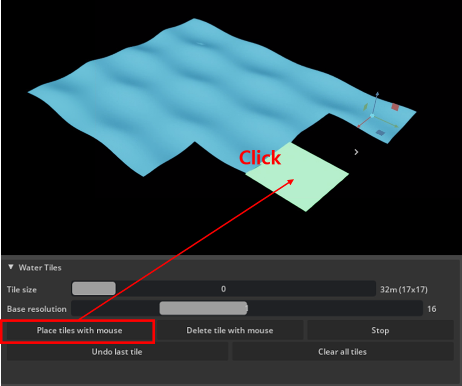
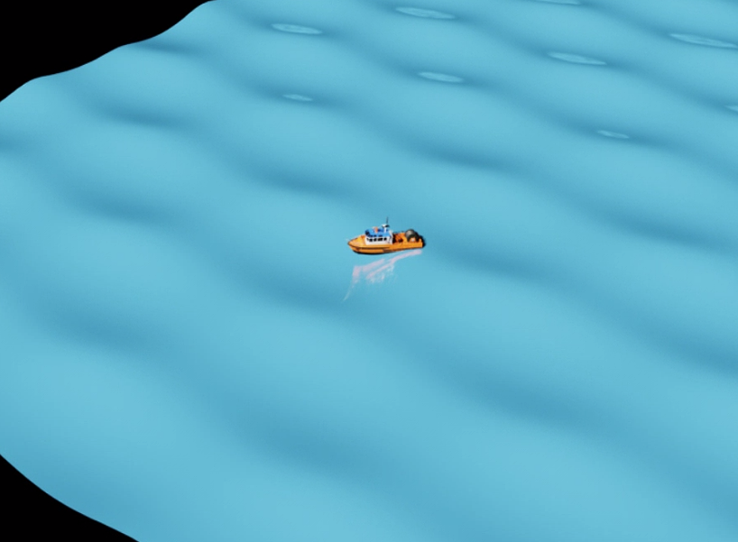
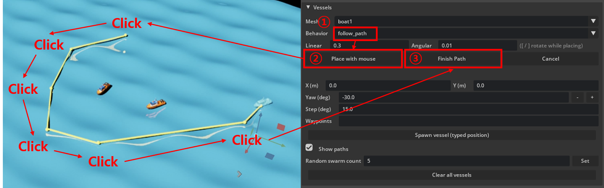

<div align="center">

# Maritime Scenario

**Physically-based waves, a controllable own ship, and autonomous vessel traffic for [NVIDIA Isaac Sim](https://developer.nvidia.com/isaac/sim) — from a panel or from Python.**


*Every boat here floats because of its own measured size, not a hand-picked spring constant.*

</div>

---

## What is in it

| | How it works | Main controls |
|---|---|---|
| **Gerstner waves** | Water is built from independent tiles (not one fixed plane), placed by mouse in a power-of-2 quadtree-style grid with T-junction-free LOD: same-size quartets auto-merge upward, differently-sized neighbors still share vertices exactly at their boundary. Distance-based tile activation plus an optional NVIDIA Warp GPU batching path keep this fast with a lot of water placed. | amplitude, wavelength, speed, steepness, wave trains, active radius |
| **Own ship** | Naval-architecture-style heave/roll/pitch — a damped oscillator per axis, not a simple 4-corner spring rig — with mass, stiffness and inertia *derived* from the hull's own measured size, not hand-picked per boat. | spawn X/Y/Z, linear/angular thrust, mesh |
| **Vessel traffic** | A random collision-free swarm, or one-at-a-time placement by mouse, typed position, or a waypoint path. Vessels (and the own ship) are held at the edge of whatever water is actually placed by an invisible wall, instead of sailing off the map. | behavior, linear/angular speed, waypoints |
| **Boat assets** | Point the extension at any folder of `.usd`/`.usdz`/`.usdc` models from the UI, no restart needed. With none registered yet, every mesh picker falls back to a simple physically-simulated placeholder box, so behavior/buoyancy/scenario layout are all testable before any real art asset exists. | mesh folder |
| **Save / load** | A scenario's full state as JSON — sea state, ship physics coefficients, own ship mesh, and every vessel's current position/behavior/remaining waypoints. | filename |

---

## Screenshots

<table>
<tr>
<td width="50%"></td>
<td width="50%"></td>
</tr>
<tr>
<td><b>Water tiles</b>, placed by mouse around the own ship's spawn point.</td>
<td><b>The own ship</b>, riding the wave surface it's actually floating in.</td>
</tr>
<tr>
<td colspan="2"></td>
</tr>
<tr>
<td colspan="2" align="center"><b>Vessel traffic</b> with waypoint paths drawn for each <code>follow_path</code> boat.</td>
</tr>
</table>

---

## Install

1. Clone this repository.
2. In Isaac Sim: **Window → Extensions → ☰ → Settings → Extension Search Paths**, add `<repo>/exts`.
3. Search for **Maritime Scenario**, enable it, and open **Window → Maritime Scenario** (it also opens
   automatically on startup).

Isaac Sim (Kit 107+). `pytest` only if you want to run the test suite outside Isaac Sim — `core/` and
several backend modules are pure-Python/pxr-only and testable without a running sim.

**Build scene** adds a basic light automatically if the stage has none at all — it won't duplicate or
override a light you (or e.g. Isaac Weather FX) already set up.

---

## Documentation

| | |
|---|---|
| [**Water & Waves**](docs/water-and-waves.md) | Gerstner wave settings, placing water tiles, the LOD/auto-merge system |
| [**Boat Assets & Scenarios**](assets/models/README.md) | Registering a boat model, how buoyancy is computed, every way to spawn a boat |

---

## Project structure

```
exts/maritime.scenario/maritime_scenario/
  core/        pure-Python logic: Gerstner wave math, ship physics, placement/collision, save/load
  backends/    the pxr/PhysX plumbing around core/ -- wave tiles, own ship, vessel traffic, mesh assets
  ui/          the UI panel + mouse-click placement controllers
  runtime/     ScenarioManager -- owns state, wires backends together
  api.py       the public Python API (the UI panel uses exactly this, nothing more)
tests/         pytest suite for everything that doesn't require a running Isaac Sim
assets/models/ where you put your own boat assets (not bundled -- see its own README)
docs/          screenshot-driven usage guides
```

---

## Built with Claude Code

This project was built in close collaboration with [Claude Code](https://claude.com/claude-code) —
design discussions, implementation, debugging, and the test suite were all developed together across many
sessions. Commits are attributed accordingly (`Co-Authored-By: Claude`).

---

## License

[MIT](LICENSE). No 3D model assets are bundled — see
[`assets/models/README.md`](assets/models/README.md) for why and how to supply your own.
