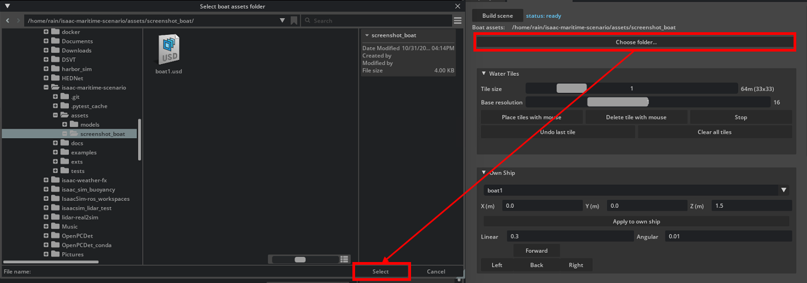
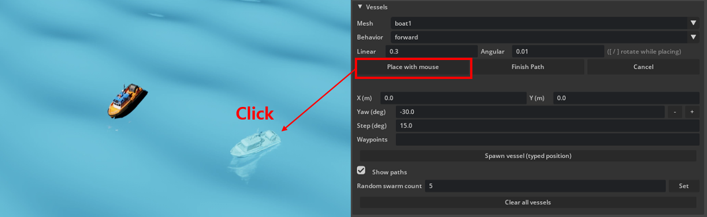

# Boat assets: registering your own models, buoyancy, and spawning

This repo does not bundle any 3D models — the ones this project was originally developed against are
third-party web-sourced assets of unclear license, so they can't be redistributed here. This guide covers
everything you need to bring your own: how the mesh registry works, how a boat actually floats once it's
in the scene, and how to get one onto the water (via the UI or the Python API).

## 1. Registering your own USD asset

### Pointing the extension at your assets folder

The easiest way: in the panel's **Setup** section, click **"Choose folder..."** and pick any folder
containing your `.usd`/`.usdz`/`.usdc` boat models. This calls
`ScenarioController.set_mesh_dir(path)` (`api.py`) under the hood, so it also works from a script without
the UI. If you never set one, it falls back to the `MARITIME_SCENARIO_MESH_DIR` environment variable,
then to this folder (`assets/models/`) by default.



### If no assets are set up yet

The mesh picker never comes up empty: with no real `.usd` files found anywhere above, every mesh
dropdown offers a single placeholder — a plain elongated box with reasonable boat-ish proportions. Spawning
it (own ship or a vessel) shows a warning in the status line ("no boat assets folder set...") but still
drops a physically-simulated box onto the water, so you can test buoyancy/behavior/scenario layout before
any real art asset exists. See `backends/meshes.py`'s `build_visual()`/`fallback_measured()`.


### Registering a real model

[`core/meshes.py`](../../exts/maritime.scenario/maritime_scenario/core/meshes.py) is a plain data registry
— a list of `(mesh_id, filename, scale, rot_x_deg)` entries, each pointing at a file inside whichever
folder is currently set (above). To add a model:

1. Drop your `.usd`/`.usdz`/`.usdc` file in that folder.
2. Add (or edit) an entry in `core/meshes.py`'s `_MODEL_SPECS` list. `mesh_id` is just a stable key used
   everywhere else in the project (vessel spawning, scenario JSON) — it doesn't have to follow the
   `boatN` naming.
3. Tune `scale` (see below) and, if needed, `rot_x_deg`.

### Scale matters — read this before you spawn anything

USD reference composition ignores `metersPerUnit` metadata. If your model's raw vertex coordinates are
in centimeters (common for web-sourced assets), a `scale` of 1.0 will spawn a boat the size of a building.
Each registry entry's `scale` is a hand-tuned constant for THAT specific model, found empirically (place
it, look at it next to the wave/own ship, adjust `scale` until its size looks right, repeat) — there's
no reliable way to derive it from the file alone.

### Off-center origin

Most web-sourced models' local origin sits at their base, not their bounding-box center.
[`backends/meshes.py`](../../exts/maritime.scenario/maritime_scenario/backends/meshes.py) measures each
model's real-world size and `local_center` once (via `UsdGeom.BBoxCache`) and places it by translating
`-scale * local_center` before scaling, so the mesh's own bbox center lands at the body's origin
regardless of where its native origin sits — you don't need to do anything for this, but if a model looks
right-sized yet sits oddly high/low or faces sideways, `rot_x_deg` (Y-up vs Z-up) or a bad `local_center`
measurement is usually why.

## 2. How buoyancy is applied

Each boat (own ship or vessel traffic) is floated by an independent damped-oscillator heave/roll/pitch
model — naval-architecture style, not a simple 4-corner spring rig — implemented in
[`core/ship_motion.py`](../../exts/maritime.scenario/maritime_scenario/core/ship_motion.py).

- **Heave** (up/down): `target_z` = the hull's resting draft-adjusted height + the wave height at the
  hull's (x, y). A spring-damper (`F_z = k_heave*(target_z - z) - c_heave*v_z`) pulls the hull toward
  that target every frame.
- **Roll / pitch**: rather than sampling the wave's slope at a single point under the hull's center (which
  breaks down for anything longer than a small dinghy — see the module's own docstring for why), this
  probes the wave height at the hull's actual bow/stern/port/starboard and fits a plane through those 4
  points. That plane's tilt in the hull's own forward/beam axes becomes the roll/pitch target, driven by
  the same spring-damper approach as heave.
- **Mass, stiffness, and inertia** are all *derived* from the hull's measured size (length/beam/height) and
  a small set of rule-of-thumb naval coefficients in `ShipPhysicsCoeffs` (draft-to-beam ratio, waterplane
  coefficient, metacentric heights, gyration radii, damping ratio) — not hand-picked per boat. These
  coefficients are tunable (`sc.set_ship_physics(...)`) but are rule-of-thumb defaults, not validated
  figures for any specific real hull.


## 3. Spawning a boat

### Via the UI

**Own ship:** "Build scene" sets up the wave infrastructure and an empty vessel pool, but does NOT spawn
an own ship by itself. In the **Own Ship** section, pick a mesh from the dropdown and click **"Apply to
own ship"** — this is also what actually spawns it the first time.

**Vessel traffic:** in the **Vessels** section, pick a registered mesh from the dropdown, choose a
behavior (`forward` / `backward` / `turn_left` / `turn_right` / `stationary` / `follow_path`), and either click
**"Place with mouse"** (click a point on the water to spawn there, or for `follow_path`, click multiple
points — the first is the spawn point, the rest become waypoints, then click **"Finish Path"**), or type a
position directly and click **"Spawn vessel (typed position)"**. The **"Random swarm count"** field +
**"Set"** button replaces everything in the scene with N randomly-placed vessels at once.



### Via the Python API

```python
from maritime_scenario import api as scenario

sc = scenario.get_controller()
await sc.setup_async()                 # builds the wave infrastructure + empty vessel pool -- once per
                                        # session; does NOT spawn an own ship by itself

sc.set_own_ship_mesh("boat3")          # spawns the own ship with this mesh (also how you swap it later)
sc.spawn_vessel("boat1", x=50, y=20, behavior="forward")
sc.spawn_vessel("boat2", x=-30, y=10, behavior="follow_path",
                 waypoints=[(0, 0), (40, 40), (80, 0)])
sc.set_vessel_count(10)                # or: replace everything with a random swarm of 10
```

`spawn_vessel`'s `mesh_id` is whatever key you registered in step 1 above — own ship and vessel traffic
both draw from the same registry.
