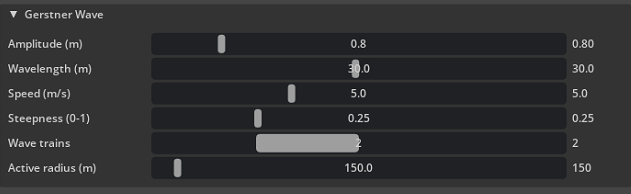
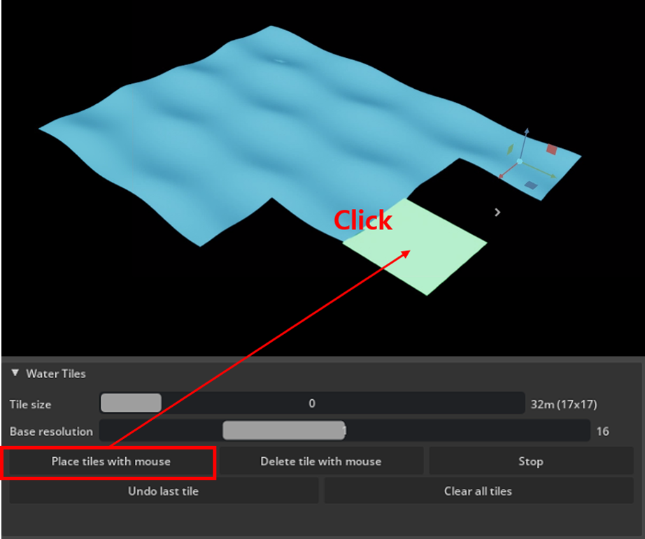

# Water & waves

How to set the sea state and lay down the water your scenario's boats float on. This covers the **Water
Tiles** and **Gerstner Wave** sections of the panel; for boat assets, spawning, and scenario setup, see
[`assets/models/README.md`](../assets/models/README.md).

## Gerstner wave settings

The **Gerstner Wave** section controls the physical sea state — shared by every tile, and by every boat's
buoyancy calculation (own ship and vessels alike):

- **Amplitude (m)**, **Wavelength (m)**, **Speed (m/s)**, **Steepness (0-1)**, **Wave trains** — the
  Gerstner wave's own parameters. Wave trains (1-4) layers multiple wave directions/speeds together for a
  less uniform-looking sea.
- **Active radius (m)** — tiles farther than this from the own ship stop animating (frozen, still
  visible) to save per-frame cost. Lower it if things get slow with a lot of water placed; it only helps
  once it's smaller than how far your tiles actually extend.

All of these apply live — drag a slider and the water updates immediately, playing or not.

## Placing water tiles

Water isn't one fixed plane — it's built from independent square tiles you place with the mouse, in the
**Water Tiles** section:

1. Pick a **Tile size** (shown as clean powers of 2: 8/16/32/64) and a **Base resolution**.
2. Click **"Place tiles with mouse"**, then click in the viewport wherever you want water. Click
   **"Delete tile with mouse"** to remove tiles the same way, or **"Stop"** to leave either mode.
3. **"Undo last tile"** removes the most recently placed tile; **"Clear all tiles"** removes everything.

A few things worth knowing about how the grid behaves:

- **Placing a bigger tile over existing smaller ones replaces them** ("coarsening") — so you can lay fine
  detail somewhere and coarser coverage everywhere else, without manually clearing anything first.
- **Four same-size tiles that happen to form a 2×2 square automatically merge upward** into one bigger
  tile, for as many levels as keep completing.
- Tiles at different sizes share vertex positions exactly at their boundaries, so there's no visible crack
  or lighting seam between a fine tile and a coarse neighbor.
- The world origin `(0, 0)` — where the own ship spawns — is kept away from a cell corner at every tile
  size, so you're never forced to place 4 tiles just to cover the ship's own starting point.

